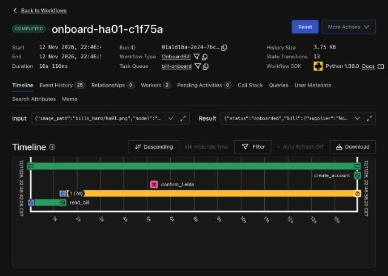

# bill-onboard

A customer switching energy supplier uploads a photo of their old bill. A vision model reads the fields, plain code checks them, the customer confirms only what the checks flagged, and a [Temporal](https://temporal.io) workflow holds the bill while they take their time, days if needed.

Everything here is invented: the suppliers, the customers and the bills. No real data was used.

```
photo ──> read_bill (model, retried by Temporal)
             │
             ▼
        check_bill (code: MPAN check digit, dates, usage × rate, total with VAT, supplier, account format)
             │
     nothing flagged ───────────────────────────────> create_account ──> onboarded
             │ something flagged
             ▼
   wait for the customer (signal, up to 7 days) ──> no answer ──> expired
             │ customer corrects the flagged fields
             ▼
        check_bill again ──> still wrong ──> needs_agent
             │ passes
             ▼
        create_account ──> onboarded
```

## Results

Two models read the same bills. Each reading is scored by playing the workflow: an honest customer corrects the fields they are shown, and the bill is checked again.

- **correct**: every field read as printed.
- **fixed by customer**: something was misread, the checks flagged it, the customer's correction made the bill right.
- **needs agent**: still wrong after the correction, so a person looks. Safe.
- **silent error**: wrong data that would reach the account. This is the number that matters.

**Main set**: 60 bills, 3 layouts, mild damage (faded, blurred, tilted), 21 with a planted error on the bill itself.

<!-- main-table -->
| Model | Read | Correct | Fixed by customer | Needs agent | **Silent errors** | Planted errors caught | Median latency | $ per 1,000 bills |
|---|---|---|---|---|---|---|---|---|
| gemini-3.5-flash-lite | 60 | 60 | 0 | 0 | **0** | 21/21 | 1.59 s | 0.83 |
| qwen/qwen3.8-27b | 46 | 36 | 8 | 2 | **0** | 13/13 | 0.83 s | 2.25 |
<!-- /main-table -->

Qwen has read 46 of the 60 so far: Groq's free tier allows 200,000 tokens a day, and the rest run when it resets.

**Hard set**: 30 bills, every one a bad phone photo (darker fade, stronger blur, up to 8° tilt, low-quality JPEG). On 15 of them one value is under a stain, so the right answer is `null`.

<!-- hard-table -->
| Model | Read | Correct | Fixed by customer | Needs agent | **Silent errors** | Stained values left empty | Median latency | $ per 1,000 bills |
|---|---|---|---|---|---|---|---|---|
| gemini-3.5-flash-lite | 30 | 16 | 6 | 7 | **1** | 15/15 | 1.71 s | 0.82 |
<!-- /hard-table -->

Cost is measured tokens times the published price on 2026-11-12: Gemini 3.5 Flash-Lite $0.30 / $2.50 per million input / output tokens, Qwen3.8-27B on Groq $0.80 / $4.00 (a preview model).

## What the evals found

- **Flash-lite read all 60 main bills right**, including the traps on layout C: rates printed in pounds, and last month's total printed near this month's. That set was too easy to tell a good model from a great one, so I added the hard set.
- **On bad photos, flash-lite gets about half the bills fully right**, and layout C, the small dense one, 0 of 10. The errors look like real OCR errors: 8 read as 6, the letter A read as 4, 2026 read as 2024.
- **It never guessed a stained value.** All 15 were returned as `null`, as the prompt asks. The report counts any filled-in stain separately, even a correct one, because a value that did not come from the bill would pass the checks if the fields it was computed from were also wrong.
- **Qwen is twice as fast but drops the MPAN's last digit** on 6 of 46 bills, and it converts pounds to pence wrongly on layout C (£0.6387 per day became 6.387p). The checks caught every one: the 13-digit length check, and the energy and total checks, because the bill no longer adds up.
- **The checks had a hole, and the evals found it.** The first scoring counted a bill as caught if any check fired. But the customer is only asked about the fields that were flagged. On one bill the total was flagged, the customer fixed it, and a wrong account number went into the account. After re-scoring by playing the workflow, the hard set showed 4 silent errors, all involving the account number, the one field nothing checked. A supplier and account-format check caught 2 of them. The customer now always sees the account number, which covers the other 2 (one digit wrong in a valid-looking number).
- **One silent error is left, and no check on the bill can catch it.** On bill `hc08` two MPAN digits were misread, and the wrong number still has a valid check digit. That happens about one time in ten for a slip of more than one digit. The real fix is looking the MPAN up in the industry meter database and matching it to the customer's address. That is not built here.

## Run it

Needs [uv](https://docs.astral.sh/uv/) and the [Temporal CLI](https://docs.temporal.io/cli). Put `GEMINI_API_KEY` (and `GROQ_API_KEY` for Qwen) in `.env`.

```bash
make test                      # 19 tests: the checks, the bill generator, and the workflow on a local Temporal server
```

The live demo uses three terminals:

```bash
make server                    # Temporal dev server, web UI at http://localhost:8233
make worker                    # runs the workflow and the model calls
make demo BILL=bills_hard/ha01.png
```

```
status: waiting_for_customer | flagged: ['standing_charge_p_per_day']
Please check these fields (Enter keeps the value as read):
  standing_charge_p_per_day [None]: 55.57
  account_number [A-162443]:
result: onboarded | account: DEMO-A-162443
```

**The step worth trying:** while the demo waits for your answer, stop the worker with Ctrl-C and start it again. Then answer. The bill finishes, because it was waiting on the Temporal server, not in the worker or the script. A real customer may answer days later, after several deploys. That is why this uses Temporal and not a plain queue.



Try `BILL=bills_hard/hb01.png` too. The usage is under a stain and the model also misread the energy charge. After the customer types the usage, the re-check finds the energy charge does not add up, and the bill goes to an agent instead of creating a wrong account.

Other commands:

```bash
make bills                     # regenerate bills/ and bills_hard/ (fixed seeds, same files every time)
make evals                     # run the models over the main set; resumes where it stopped
PYTHONPATH=src uv run python evals/run.py --hard        # the hard set
PYTHONPATH=src uv run python evals/report.py            # re-score saved readings, no API calls
```

## How it is built

| File | What it does |
|---|---|
| `src/bill_onboard/models.py` | `Bill`: the fields. Every field can be `None`, so a model can say "unreadable" instead of guessing. |
| `src/bill_onboard/checks.py` | Plain code, no model: MPAN check digit, billing dates, usage × rate = energy charge, (energy + standing × days) × 5% VAT = total, known supplier, account number format. |
| `src/bill_onboard/extract.py` | One function reads a bill with any model through an OpenAI-compatible endpoint. Its own retries are off, so Temporal owns them. |
| `src/bill_onboard/workflow.py` | `OnboardBill`: activities for the model call and account creation, a signal for the customer's answer, a query for progress. |
| `src/bill_onboard/fake_bills.py` | Invented bills drawn in 3 layouts, with planted errors, damage, and stains. |
| `evals/run.py`, `evals/report.py` | Saves every raw reading, then scores them. Scoring can change without paying for new model calls. |

The evals call the model directly, not through Temporal, because they measure the reader. The workflow logic is covered by `tests/test_workflow.py`.

## Limits

- **Invented data.** Three made-up layouts and suppliers. Real bills vary far more, so real accuracy will be lower than the main set suggests. The hard set is closer.
- **Small samples.** 60 and 30 bills. One bill moves a layout's score by 5 or 10 points, which is why the tables show counts, not percentages.
- **MPAN check digit.** The method is the published mod-11 one, tested on generated numbers, not on real MPANs.
- **An honest customer.** The scoring assumes the customer types the right value. A careless one is partly covered by the re-check, which sends the bill to an agent.
- **One model left out.** Gemini 3.8 Flash read one test bill correctly, but the call took 408 seconds, mostly the client's own retries after 503 errors (those retries are now off). In the eval run it returned 503 errors or timed out on the first 6 bills, then hit its free-tier limit of 20 requests a day.
- **Not built:** reminders while the customer has not answered, the meter-database lookup, and a second model to cross-check unchecked fields.
- Layout B prints dates with `%-d`, which works on macOS and Linux only.

The bills use the [DejaVu Sans](https://dejavu-fonts.github.io) font, included under its own license in `fonts/`.
